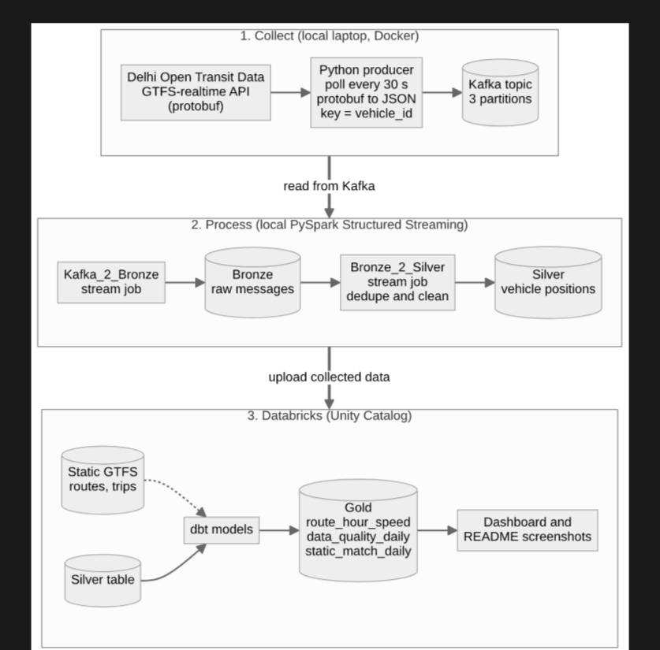
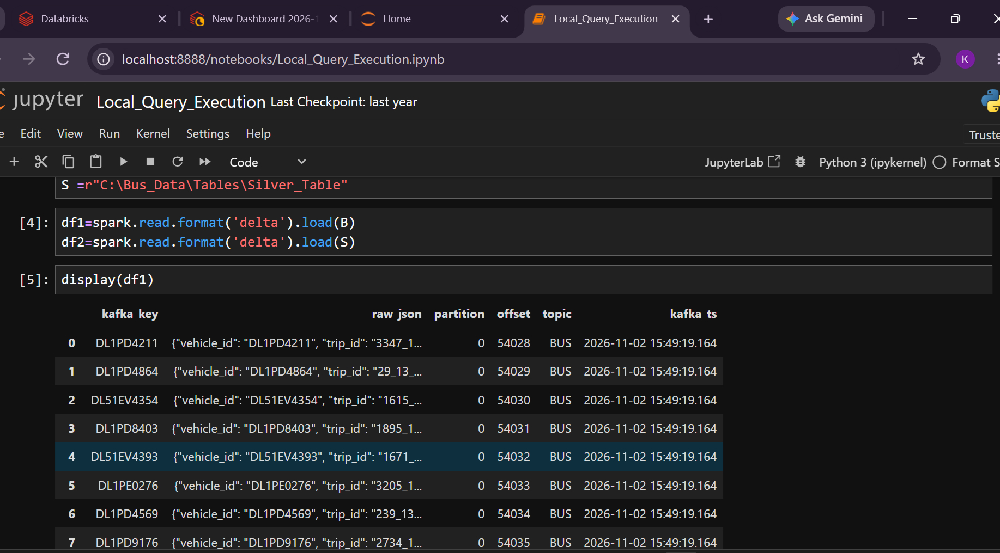
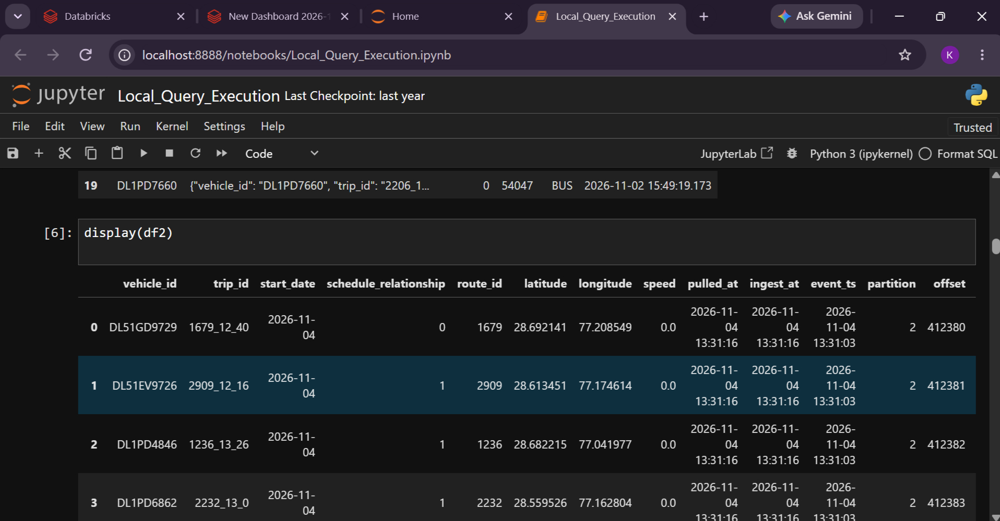
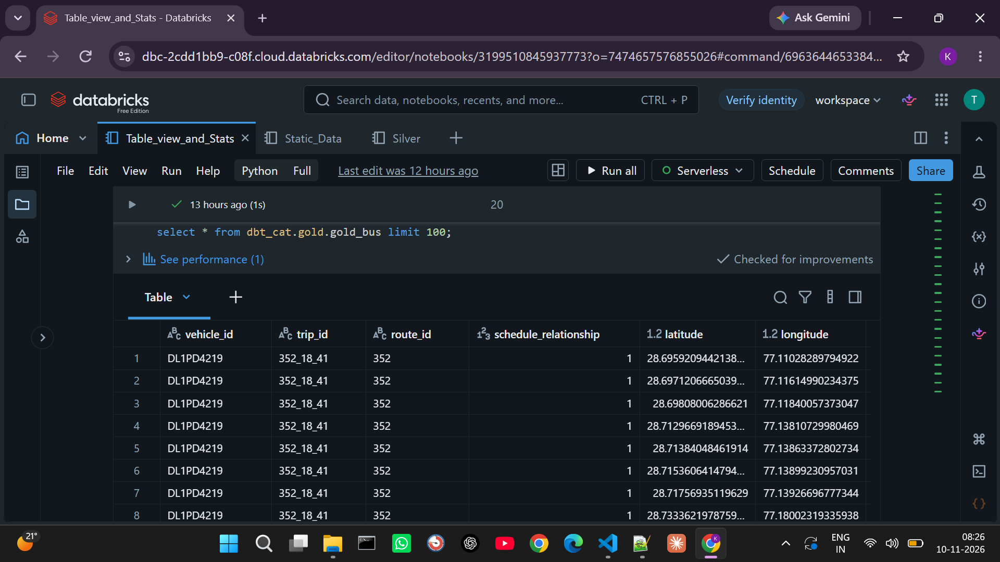
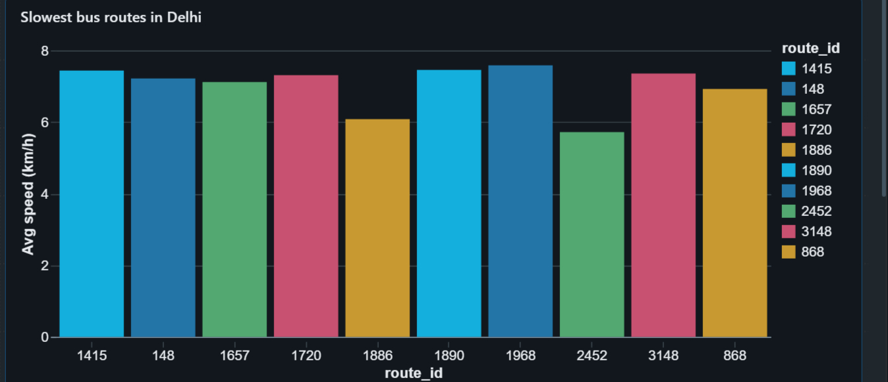
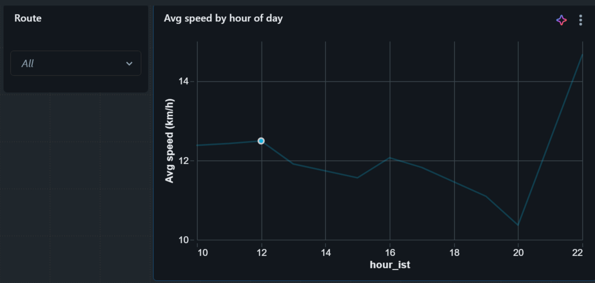
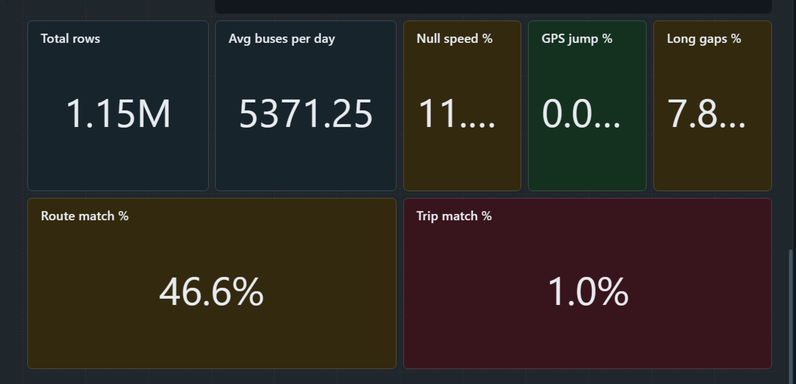

# Delhi Bus Delay Tracker

A data engineering project that collects live bus positions from Delhi's open transit data, cleans them, calculates speed from the GPS points, and shows which routes and hours are slowest.

## Why I built this

Delhi publishes live GPS positions for its buses, but the raw feed does not tell you how the service is really doing. I wanted to answer simple questions from that data:

- Which routes are the slowest?
- How does bus speed change during the day?
- How much of the live data can I trust?

The last question turned out to matter as much as the first two. The feed is messy, and a large part of this project is about finding that out and handling it.

## Architecture



1. **Collect:** a Python producer polls the Delhi real-time API every 30 seconds, converts the protobuf response to JSON, and sends one message per bus to a Kafka topic (Kafka runs in Docker). The message key is the vehicle ID, so every update from one bus stays in order.
2. **Process (local):** two PySpark Structured Streaming jobs run on my laptop. `Kafka_2_Bronze` stores the raw messages, and `Bronze_2_Silver` cleans them.
3. **Upload:** the collected data is moved into Databricks (Unity Catalog).
4. **Model (Databricks):** dbt builds the gold tables from silver, joined with the static GTFS tables where needed.

<!-- CHECK: write one line on how you move the data into Databricks (upload to a Volume, CSV, Parquet...). -->

**Why the stream jobs run locally:** my first design read Kafka from Databricks through a public tunnel. The tunnel dropped several times and my Databricks Free Edition account was removed more than once, so I moved collection and streaming to my laptop and use Databricks for the gold layer.

## Data sources

| Data | Source | Used for |
|---|---|---|
| Real-time bus positions | [Delhi Open Transit Data](https://otd.delhi.gov.in/) (GTFS-realtime, protobuf) | Live positions of buses |
| Static timetable (routes, trips, stops) | GTFS static feed for Delhi buses | Matching live routes and trips to the timetable |

The real-time feed needs a free API key from the portal. The official static download did not work for me, so I used a public copy of the same feed, with service dates from 2022 to 2024. It is older than the live feed, which causes the match problem described under Limitations.

Data is credited to the Delhi Open Transit Data platform (Department of Transport, GNCTD, with IIIT-Delhi) and used for a non-commercial student project, following the portal's terms. Only bus positions are used, never anything about individual people.

## Tech stack

Python, Apache Kafka (Docker), PySpark Structured Streaming, Delta Lake, Databricks (Unity Catalog), dbt Core (`dbt-databricks`), SQL.

## Repository structure

```
Architecture/          architecture diagram (png)
DashBoards/            screenshots of the dashboards and table outputs
DBT_Fol/               dbt project: models for silver and gold
Producer/              API to Kafka producer
Static_Table_Creation/ code that creates the static tables in Databricks
Stream Jobs/           the two Structured Streaming jobs
```

## How the data is processed

| Layer | What happens |
|---|---|
| **Bronze** | Raw JSON messages exactly as received, plus the Kafka key, partition, offset and timestamp. Nothing is changed or dropped. |
| **Silver** | Messages are parsed with a fixed schema, timestamps are converted.
| **Gold** | dbt models: `gold_bus`,`gold_route_hour_speed`, `gold_data_quality_daily`, `gold_static_match_daily`, plus a `rejected_rows` table for rows that fail checks. |

**gold_bus model** | In the gold_bus model iam filtering not null values using vehicle_id and event_ts is not null ,and dropping duplicates ,and calculating speed using haversine formula,and this source model for other models

### How speed is calculated

The API's own `speed` field is `0.0` in every row, so it is not usable. I calculate speed from the GPS points instead:

1. For each bus, take its previous report (ordered by event time).
2. Calculate the distance between the two points (haversine formula, in metres).
3. Divide by the seconds between the two reports, and convert to km/h.

Rules that keep the numbers honest:

| Rule | Why |
|---|---|
| Gap over 10 minutes: no speed (null) | The bus could have gone anywhere, and a straight line says little about the real route |
| Moved under 10 m: speed 0 | GPS jitter on a parked bus |
| Over 100 km/h: flagged as a GPS jump, speed null | A city bus does not do that |
| First report of a bus: no speed | There is no previous point |

## Results

**Pipeline output:** row counts and sample rows from each layer.





**Slowest routes in Delhi**



What it shows: it shows slowest bus routes with avg speed

**Average speed by hour of day**



What it shows: Every hour avg speed of bus moves in diffrent type of routes

**Data quality**



What it shows: Quality checks like  null percentages ,percentage of gps_jumps,max(event_delay) to reach target.and percentage of ids matches from static table to live tables
Null speed is **11%** ,gps_jumps is **0.0 %** ,long_gap is **7.8%**

**Match with the static tables**

Only **46.6%** of live routes and **1.0%** of live trips exist in the static data.

## Limitations

- **The API speed field is always 0**, so speed is estimated from GPS points. A straight line between two points is shorter than a curved road, so the speed is slightly underestimated. It is good for comparing routes and hours, not for exact speed.
- **The static data is older than the live feed**, so a large part of live routes and trips cannot be matched. Because of that, the analysis is at route level and not stop level.
- **Data is collected only while my laptop is on**, not around the clock. Gaps are left as null and measured in the data quality table.
- **Kafka runs locally.** A production setup would use a managed broker.

## What I would do next

- Get a static feed that matches the live feed and add stop-level analysis.
- Find bus bunching (several buses of one route close together).
- Schedule the pipeline with Airflow.
- Add dbt tests for the silver table.

## How to run

You need: Python 3.12, Docker, a Databricks workspace, and a free API key from the Delhi Open Transit Data portal.

1. Clone the repo, create a virtual environment and install the packages.
2. Create a `.env` file with `OTD_API_KEY=your-key`. This file is in `.gitignore` and is never committed.
3. Start Kafka: `docker compose up -d`  
4. Start the producer: `python Producer/<Producer1>.py`
5. Start the stream jobs: `python "Stream Jobs/<kafka_2_bronze file>.py"` and `python "Stream Jobs/<bronze_2_silver file>.py"`
6. Create the static tables in Databricks with the code in `Static_Table_Creation/` 
7. Upload the collected data to Databricks.
8. Set `DATABRICKS_HOST`, `DATABRICKS_HTTP_PATH` and `DATABRICKS_TOKEN` as environment variables, then in `DBT_Fol/<project>`: `dbt debug` and `dbt run`.

No keys or tokens are stored in this repo.

## Author


Naveen Kumar · [LinkedIn](https://www.linkedin.com/in/naveen-kumar-434703383/) · [GitHub](https://github.com/Naveen-Kumar-0627)
